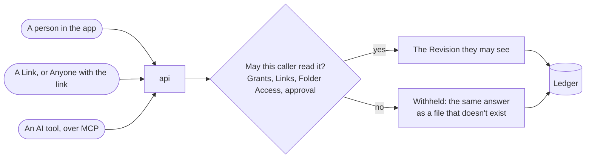
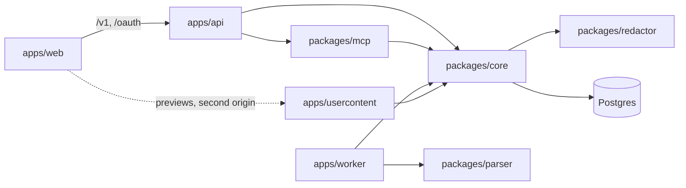

# Exagram

Exagram keeps the documents a team already writes — a doc, a spreadsheet, a deck, a saved conversation — in one place,
and lets an AI client read exactly the ones you have shared with it. An Owner can require approval before anything is
published, every read is recorded, and what one person can read is decided in one place in the database rather than in
each screen.

The words this codebase uses, and what each one means, are in [CONTEXT.md](CONTEXT.md). Read that first: they are the
same words in the schema, the API and the screens.

## Features

- **One store for every kind of file.** Markdown and text docs, HTML pages, chat transcripts, and uploaded PDF, docx,
  pptx, xlsx and image files. Text is extracted from uploads so AI tools can read them.
- **Revisions and approval.** Every change is a new Revision with full history and restore. A Publish Policy decides
  whether new Revisions go live at once or wait for the Owner to approve them.
- **Folders and sharing.** Folders with subfolders, shared per person or with a Group as view, collaborate or edit. A
  share follows the latest Revision or is pinned to one. People can ask for access from a file they can't open.
- **Links.** Expiring anonymous links to one Revision, with an optional view limit, and "Anyone with the link" access
  with an optional password.
- **AI tools over MCP.** Claude, ChatGPT, Cursor and other MCP clients connect through OAuth. They can list, read,
  search and upload files and manage shares, within the scopes the person approved. Each Connection can be narrowed to
  chosen folders, and it never reaches more than its person does.
- **A Ledger of every read.** Owners see who read their files, through which Connection or Link, and which Revision.
  Admins see the whole install in Audit.
- **Working together.** Comments on Revisions, an Activity feed, in-app notifications and live updates. Each person has
  a Personal Workspace and can create or join a team.
- **Sign-in.** Email and password, Google, and Sign in with Apple.
- **Runs on your infrastructure.** Docker Compose or Helm, with a bundled or your own Postgres and object store
  (filesystem, S3-compatible or Google Cloud Storage).

## How a read works

People, Links and AI tools all read through the same path. Whether a caller may read an Artifact is decided in one
place, in Postgres, and every read is written to the Ledger, including Withheld reads.



A Withheld read looks like a missing file, so a caller can't learn that a file exists by asking for it. The one
exception is a file shared with Anyone with the link: its reader is asked for the password, or told the link has
expired. A Connection never reaches more than the person who approved it, and Folder Access narrows it further.

## What is in the box



| Piece       | Where               | What it does                                                                                            |
| ----------- | ------------------- | ------------------------------------------------------------------------------------------------------- |
| API         | `apps/api`          | The human API at `/v1`, the MCP endpoint at `/mcp`, the OAuth server at `/oauth`                        |
| Worker      | `apps/worker`       | Extracts text from uploads, passes each Revision through the Redactor, sweeps expired Links and uploads |
| Usercontent | `apps/usercontent`  | A second origin that serves HTML bodies and the PDF viewer under a strict CSP                           |
| Web         | `apps/web`          | The screens                                                                                             |
| Core        | `packages/core`     | The API contract, entities, repositories, and the read path that applies visibility and the Ledger      |
| MCP         | `packages/mcp`      | The tools an AI client calls                                                                            |
| Parser      | `packages/parser`   | Text extraction for docx, pdf, pptx and xlsx                                                            |
| Redactor    | `packages/redactor` | The `Detector` interface and the parser for placeholders such as `[EMAIL]`                              |

The worker passes every Revision through the configured `Detector`. The built-in detector reports no Findings; it
records the placeholders an author typed, so a Connection's Revision that carries one waits for the Owner's approval.

## Running it locally

You need Git, Node 24 with pnpm 11 (`corepack enable`, or `mise install`), OpenSSL, and Docker with Compose. The
database scripts run `psql` and `migrate` in containers on the host network, so on macOS use OrbStack, or Docker Desktop
with host networking turned on (Settings → Resources → Network). Linux works as is.

```bash
pnpm install
make local-db-up      # starts Postgres on 127.0.0.1:25432
make local-db-init    # writes .env, creates and migrates the database
```

OAuth, and with it every AI client, needs a signing key. `.env` starts with an empty key set, which lets the API start
but cannot sign anyone in through OAuth. Put a fresh RSA key in it:

```bash
sed -i.bak '/^OIDC_JWKS=/d' .env && rm .env.bak
printf 'OIDC_JWKS=%s\n' "$(openssl genrsa 2048 2>/dev/null | awk '{printf "%s\\n", $0}')" >> .env
```

Then start the apps:

```bash
docker compose up
```

Open http://localhost:5173 and sign up; the first account is the Admin. The app, the API, the MCP endpoint and the OAuth
server are all on that one origin: the web app proxies `/v1`, `/oauth`, `/mcp` and `/.well-known` to the API so the
session cookie and the OAuth interaction cookie stay first-party. HTML bodies are the deliberate exception and are
served from http://localhost:3002 instead, sandboxed.

To look at the data with a GUI client, connect to host `127.0.0.1`, port 25432, user and password `exagram`, database
`exagram`.

## Connecting an AI client

Sign in, open **Connections**, and copy the server URL (`http://localhost:5173/mcp` locally). The client sends you back
to Exagram to consent, where you choose what it may do; it then reaches everything you reach. You can revoke it later on
the same page, which stops tokens it already holds.

Locally, use a client that connects from your own machine:

- **Claude Code**: `claude mcp add --transport http exagram http://localhost:5173/mcp`
- **Cursor**: add an MCP server with that URL.

Claude.ai, Claude Desktop's custom connectors and ChatGPT connect from their providers' servers, so they can't reach
`localhost`. They need an install with a public address; see
[Connect AI tools](docs/self-host/accounts.md#connect-ai-tools).

## Running it on a server

[docs/self-host.md](docs/self-host.md) covers installing Exagram on your own infrastructure with Docker Compose,
Kubernetes or Cloudflare.

## Contributing

[CONTRIBUTING.md](CONTRIBUTING.md) covers the checks to run, the conventions, and how pull requests are reviewed.
Everyone taking part follows the [Code of Conduct](CODE_OF_CONDUCT.md).

## License

Copyright (C) 2026 Cleverse.

Exagram is licensed under the GNU Affero General Public License v3.0 only (`AGPL-3.0-only`); see [LICENSE](LICENSE).

To report a vulnerability, see [SECURITY.md](SECURITY.md).
