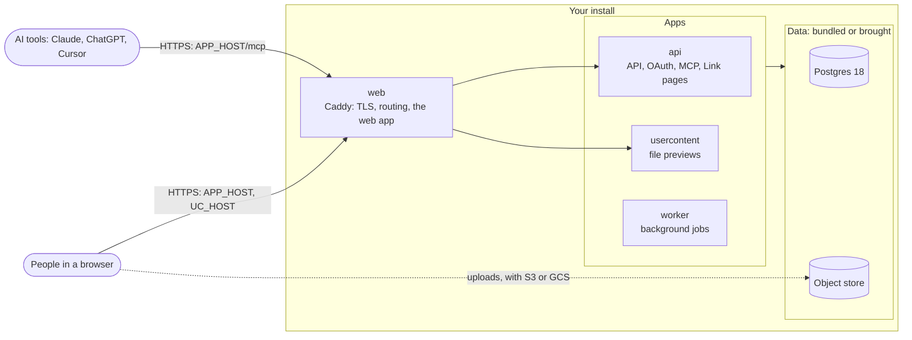
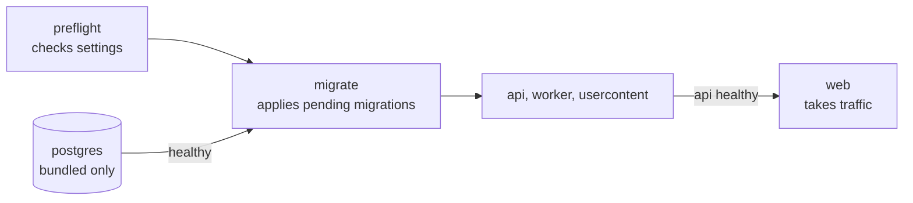
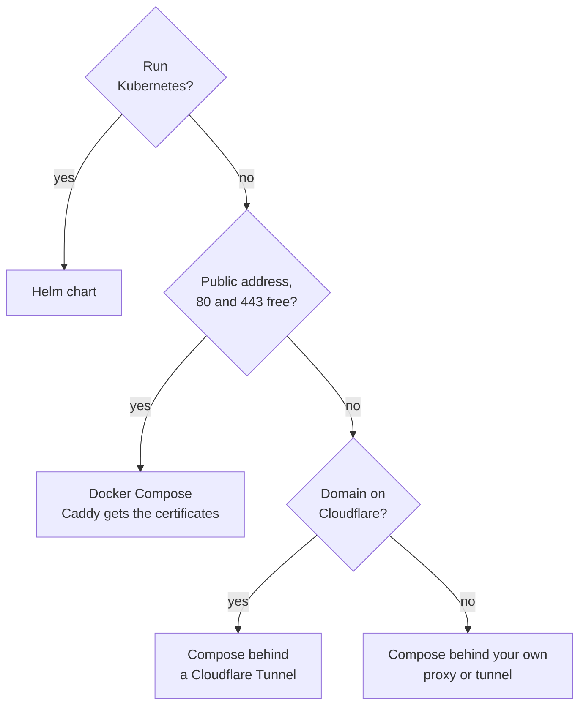

# Self-hosting Exagram

Exagram runs on your own infrastructure from signed images for `linux/amd64` and `linux/arm64`. Install it with Docker
Compose on one machine, or with a Helm chart on Kubernetes. Your documents, the Ledger of who read them, and every
signing key stay on servers you control. Exagram sends no telemetry (see [Security](self-host/security.md)).

- **One machine is enough.** Start a small team on 2 vCPU and 4 GB of memory, database and files included.
- **One script writes the configuration** and generates every secret on your machine; Caddy gets the certificates.
- **Every release is signed**, and the bundle pins each Exagram image by digest.
- **AI tools connect to your address**, over MCP with OAuth sign-in, and every read they make is in the Ledger.

This page is the overview. Each topic has its own page:

| Page                                                        | What it covers                                                              |
| ----------------------------------------------------------- | --------------------------------------------------------------------------- |
| [Requirements](self-host/requirements.md)                   | Sizing, software versions, DNS and ports, every outbound connection         |
| [Install with Docker Compose](self-host/install-compose.md) | One machine or VM, with every database, storage and TLS choice              |
| [Install with Helm](self-host/install-helm.md)              | Kubernetes, with two required values                                        |
| [Install on Cloudflare](self-host/install-cloudflare.md)    | Compose behind a Cloudflare Tunnel, files in R2, no open ports              |
| [Configuration](self-host/configuration.md)                 | Every setting, optional features, the database and bucket you bring, limits |
| [Networking](self-host/networking.md)                       | TLS modes, proxies and tunnels, the client address, routes                  |
| [Accounts](self-host/accounts.md)                           | The first Admin, invites, password resets, connecting AI tools              |
| [Operations](self-host/operations.md)                       | Verify, monitor, upgrade, back up, restore, uninstall                       |
| [Security](self-host/security.md)                           | What leaves your install, hardening checklist, what an operator can see     |
| [Troubleshooting](self-host/troubleshooting.md)             | Symptoms and fixes, and what to collect before asking for help              |

## What runs



| Service       | Role                                                                                                    |
| ------------- | ------------------------------------------------------------------------------------------------------- |
| `web`         | Caddy with the web app (`caddy` in Compose): serves the app, routes API, OAuth and MCP calls, holds TLS |
| `api`         | HTTP API, OAuth and MCP. One replica only                                                               |
| `worker`      | Background jobs: parsing uploads for search, revoking expired Links, cleanup sweeps                     |
| `usercontent` | Serves previewed files from their own origin, `UC_HOST`                                                 |
| `preflight`   | One-shot: checks the database URLs and storage settings before anything touches the database            |
| `migrate`     | One-shot: applies pending migrations before the apps start                                              |
| `postgres`    | The bundled database, when you don't bring one                                                          |

People open `APP_HOST`. Previewed files (HTML Artifacts, PDFs) come from a second origin, `UC_HOST`, so a file's scripts
can never act as the signed-in person. `UC_HOST` defaults to `APP_HOST` with `-files` after its first label
(`exagram.acme.com` gives `exagram-files.acme.com`). Both need DNS records.

### Start order

On Compose, every `docker compose up`, the first and each upgrade, runs this chain. Nothing reaches the database until
`preflight` has accepted the settings, and no app runs against a schema older than its own.



If `preflight` or a migration fails, the chain stops there and the apps don't start; its log names the problem (see
[Troubleshooting](self-host/troubleshooting.md)). On Helm the same two checks run as a Job, and `api`, `worker` and
`usercontent` each wait for the schema version they need. `web` does not wait: during an upgrade the new web app can
serve before the new `api` is ready (see [Upgrade with Helm](self-host/operations.md#upgrade-with-helm)).

### Bundled or brought

The database and the object store are each either **bundled** or **brought** by you:

| Layer        | Bundled                                                       | Brought                                                  |
| ------------ | ------------------------------------------------------------- | -------------------------------------------------------- |
| Database     | A `postgres:18` container (Compose) or StatefulSet (Helm)     | Any Postgres 18 you run, over verified TLS               |
| Object store | A Docker volume (Compose) or one PersistentVolumeClaim (Helm) | S3 API (AWS, Cloudflare R2, any compatible store) or GCS |

Bundled layers need nothing beyond Docker or the cluster. For production data, bring them: your provider's backups and
durability then cover them. Choose before you store anything (see [Not supported](#not-supported)).

## Choose an install



| Install                                                            | Use it when                                                                         |
| ------------------------------------------------------------------ | ----------------------------------------------------------------------------------- |
| [Docker Compose](self-host/install-compose.md)                     | One machine or VM. The simplest to run and to back up.                              |
| [Helm](self-host/install-helm.md)                                  | You already run Kubernetes. Two required values; the chart generates every secret.  |
| [Cloudflare](self-host/install-cloudflare.md)                      | Your domain is on Cloudflare. The machine needs no public address and no open port. |
| [Behind a proxy](self-host/networking.md#behind-a-proxy-or-tunnel) | Something in front of the machine already holds TLS, such as nginx or a tunnel.     |

## Quick start

The shortest install: one Linux machine with Docker, the bundled database and store, and Caddy getting its own
certificates. Before you start, point DNS A records for `exagram.example.com` and `exagram-files.example.com` at the
machine, and open ports 80 and 443.

```sh
VERSION=vX.Y.Z
docker run --rm ghcr.io/cleverse/exagram-deploy:$VERSION | tar x
cd exagram
./gen-secrets.sh --app-host exagram.example.com --acme-email admin@example.com
docker compose up -d
./verify.sh
```

`verify.sh` ends with `all checks passed`. On Kubernetes, the same install is one command:

```sh
helm install exagram oci://ghcr.io/cleverse/charts/exagram --version X.Y.Z \
  --namespace exagram --create-namespace \
  --set appHost=exagram.example.com --set acmeEmail=admin@example.com \
  --wait --wait-for-jobs --timeout 15m
```

Then point DNS at the address the install prints. Either way, finish by opening `https://exagram.example.com` and
creating the first account, which becomes the Admin (see [First account](self-host/accounts.md#first-account)).

Replace `vX.Y.Z` with a release tag; there is no `latest` (see [Versions](self-host/operations.md#versions)). For
production, verify the bundle's signature first, as [Install with Docker Compose](self-host/install-compose.md) shows.

## After the install

In this order, the first day:

1. **Create the Admin** before you share the address: the first account on an empty install becomes the Admin
   ([First account](self-host/accounts.md#first-account)).
2. **Create a team and invite people** with invite links from **Settings → Team**
   ([Inviting people](self-host/accounts.md#inviting-people)).
3. **Connect an AI tool** at `https://APP_HOST/mcp` ([Connect AI tools](self-host/accounts.md#connect-ai-tools)).
4. **Schedule backups** of the secrets, the database and the files, and restore one once
   ([Backup](self-host/operations.md#backup)).
5. **Monitor** both `/readiness` endpoints and the certificates ([Monitor](self-host/operations.md#monitor)).
6. **Work through** the [hardening checklist](self-host/security.md#hardening-checklist).

## What you are responsible for

Exagram ships the images, the bundle and the chart. Running them is yours:

- DNS for both host names, and TLS when a proxy in front holds the certificates.
- Backups of the database, the files and the secrets, and testing that they restore
  ([Backup](self-host/operations.md#backup)). Nothing backs up automatically.
- Updates to the operating system, Docker or Kubernetes, and upgrading Exagram to new releases.
- Watching that the install is up ([Monitor](self-host/operations.md#monitor)).
- Who has a shell on the server or access to the cluster: they can read the database and create sign-in links for any
  password account ([What an operator can see](self-host/security.md#what-an-operator-can-see)).

## Not supported

- More than one `api` replica, or any high-availability setup. Each install is one copy of each app.
- Switching an existing install from one store to another: the database holds object keys, so moving means copying the
  objects yourself.
- A separate migrator and app database role, connection poolers, and Postgres versions other than 18 (untested).
- Plaintext or unverified database TLS outside the opt-ins in the
  [Postgres contract](self-host/configuration.md#postgres-contract).
- Azure Blob storage (no S3 API), and GCS through its S3 interoperability endpoint.
- Uploads larger than 20 MiB. The limit is fixed.
- Air-gapped installs: image pulls, and certificates in the default mode, need internet access.

Password resets are links an Admin creates and sends, never email (see
[Password reset](self-host/accounts.md#password-reset)).
