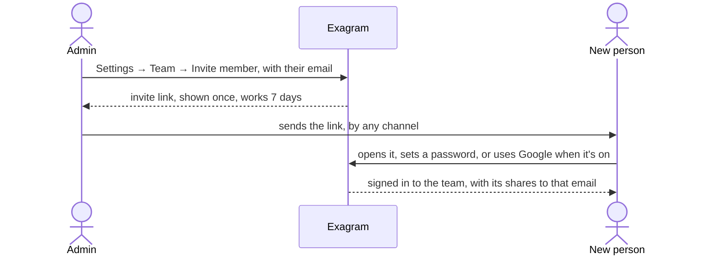
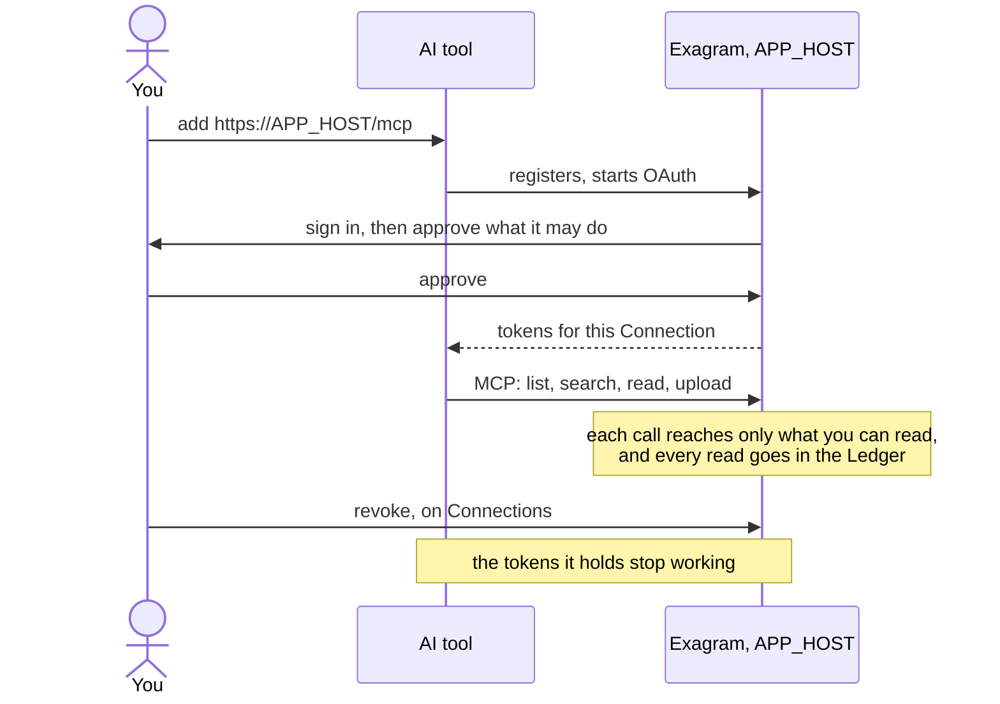

# Accounts

[Self-hosting overview](../self-host.md) · Accounts

## First account

On an empty install, the first person to sign up becomes the Admin. Do it right after the first start, before you share
the address: open `https://APP_HOST`, choose **Create one**, and fill in your name, email and password. With Google
sign-in on, the page offers only Google: you sign up with your Google account instead.

The first account starts with only its own files. Invites go to a team, so create one before inviting anyone: open
**Settings → Team**, choose **Create team**, and name it. You become its owner and an Admin of it; your own files stay
yours.

After the first account, sign-up is closed. New people join through an invite, or with Google sign-in for an email that
has a pending invite or that someone has already shared files with.

## Inviting people

An Admin opens **Settings → Team**, chooses **Invite member**, enters the person's email, and chooses **Create invite
link**. The link is shown once and works for 7 days. Copy it and send it to the person.



The person opens the link, sees the invite, and sets a name and password for that email. With Google sign-in on, joining
is through Google only, with that email; there is no password form. Files shared with that email before they joined
start working when they do; shares from anyone outside the team wait until they sign in with Google or Apple on that
email.

Pending invites are listed on the same page. **Copy new link** makes a fresh link and stops the old one. **Revoke**
cancels the invite.

## Password reset

Password resets are never emailed. A forgotten password is reset with a Reset Link.

- **A Member forgot their password.** An Admin opens **Settings → General → Reset a password**, enters the Member's
  email, and chooses **Create reset link**. The link is shown once, works once, and expires in an hour; send it
  yourself. Using it sets a new password and signs that person out of every browser; their AI tool Connections keep
  working. Creating and using a Reset Link are both recorded in the Ledger, visible in **Settings → Audit**. Admins, and
  people who sign in only with Google, aren't offered one here.
- **An Admin forgot their password.** On the server:

  ```sh
  # Compose, in the exagram/ folder
  docker compose exec api node dist/cli.js reset-link you@example.com
  # Helm
  kubectl --namespace exagram exec deploy/exagram-api -c api -- node dist/cli.js reset-link you@example.com
  ```

  It prints a Reset Link for that account, which works the same way. It works only for an account with a password; an
  Admin who signs in only with Google gets back in through Google.

A Reset Link lets an Admin sign in as that Member, which the Ledger and the ended sessions make visible.

## Connect AI tools

The MCP server URL is `https://APP_HOST/mcp`; the app also shows it on the **Connections** page. AI tools reach it from
their providers' servers, so `APP_HOST` must be reachable from the internet, and a laptop install answers only while the
laptop is awake and online.

- **Claude** (claude.ai, Claude Desktop): Settings → Connectors → Add custom connector, with the URL above.
- **ChatGPT**: add a custom MCP connector with the URL above, where your ChatGPT plan allows custom connectors.
- **Claude Code**: `claude mcp add --transport http exagram https://APP_HOST/mcp`.

The tool sends you to Exagram to sign in and approve the Connection, where you choose what it may do. It then reaches
what you reach, and every read is recorded in the Ledger. On the same Connections page you can narrow a Connection to
chosen folders, or revoke it, which stops the tokens it already holds.


