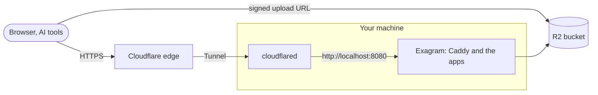

# Install on Cloudflare

[Self-hosting overview](../self-host.md) · Install on Cloudflare

Run Exagram on any machine (a small VM, a server in your office) behind a Cloudflare Tunnel, with files in Cloudflare
R2. The machine needs no public address and no open inbound port. Cloudflare holds the certificates, and R2 keeps your
files off the machine's disk.



This is the [Compose install](install-compose.md) with two choices made: `--tls external` with the client address from
`Cf-Connecting-Ip`, and R2 as the store. The tunnel and R2 haven't been verified on real Cloudflare accounts yet (see
[Provider status](configuration.md#provider-status)); the same stack is tested end to end with a local S3 store behind a
plain-HTTP origin carrying `Cf-Connecting-Ip`.

## What you need

- A domain on Cloudflare (its DNS managed by Cloudflare).
- A Cloudflare account with R2 enabled.
- A machine with Docker and Compose 2.24.4 or later (see [Requirements](requirements.md)).
- Two host names on that domain. This page uses `exagram.example.com` and `exagram-files.example.com`. Keep `UC_HOST`
  one level deep beside `APP_HOST`, as the default is, so Cloudflare's certificate for `example.com` covers both.

## 1. Create the bucket

In the Cloudflare dashboard, under **R2 Object Storage**:

1. **Create bucket**, named `exagram`. Leave public access off: no `r2.dev` URL and no custom domain. Presigned URLs
   don't work on custom domains, and the bucket must stay private.
2. In the bucket's **Settings → CORS Policy**, add:

   ```json
   [
   	{
   		"AllowedOrigins": ["https://exagram.example.com"],
   		"AllowedMethods": ["PUT"],
   		"AllowedHeaders": ["Content-Type", "If-None-Match"],
   		"MaxAgeSeconds": 3600
   	}
   ]
   ```

   Browsers upload straight to the bucket; this lets them do it from your app and nowhere else.

3. **Manage R2 API Tokens → Create API token** with **Object Read & Write**, scoped to the `exagram` bucket. Note the
   Access Key ID, the Secret Access Key, and your account ID (in the S3 endpoint it shows,
   `https://<account>.r2.cloudflarestorage.com`).

## 2. Generate the configuration

On the machine, download the bundle (see [Install with Docker Compose](install-compose.md#1-download-the-bundle)), then
from the `exagram/` folder:

```sh
export S3_BUCKET=exagram S3_REGION=auto S3_ACCESS_KEY_ID=<access key id> S3_SECRET_ACCESS_KEY=<secret access key>
export S3_ENDPOINT=https://<account>.r2.cloudflarestorage.com S3_PUBLIC_ENDPOINT=https://<account>.r2.cloudflarestorage.com
./gen-secrets.sh --app-host exagram.example.com --storage s3 --tls external --client-ip-header Cf-Connecting-Ip
```

Caddy will serve both host names as plain HTTP on `127.0.0.1:8080`, routing by host name, and take the client address
from `Cf-Connecting-Ip` only when the request comes from a private address such as the tunnel connector.

The database is bundled here. To keep it off the machine as well, add `--external-db` with a hosted Postgres 18's URLs
(Neon, for example); see [Your own database](install-compose.md#your-own-database).

## 3. Start Exagram

```sh
docker compose up -d
./verify.sh
```

`verify.sh` checks the stack at `127.0.0.1:8080` before the tunnel exists.

## 4. Create the tunnel

In the Cloudflare dashboard, under **Zero Trust → Networks → Tunnels**:

1. **Create a tunnel** of type **Cloudflared**, and name it `exagram`.
2. Install the connector on the machine with the command the dashboard shows. As a container on Linux, it must share the
   host's network to reach `localhost:8080`:

   ```sh
   docker run -d --name cloudflared --restart unless-stopped --network host \
     cloudflare/cloudflared:latest tunnel --no-autoupdate run --token <tunnel token>
   ```

3. Add two **public hostnames**, both of type HTTP to `localhost:8080`:

   | Public hostname             | Service                 |
   | --------------------------- | ----------------------- |
   | `exagram.example.com`       | `http://localhost:8080` |
   | `exagram-files.example.com` | `http://localhost:8080` |

   Cloudflare creates the DNS records. Keep the original host name (don't set an HTTP Host Header override): Caddy
   routes by it.

## 5. Check and sign in

```sh
VERIFY_PUBLIC=1 ./verify.sh
```

This checks the stack through the tunnel at `https://exagram.example.com`. After your first upload, check the bucket
too: find the upload's storage key and run `VERIFY_OBJECT_KEY=<storage key> VERIFY_PUBLIC=1 ./verify.sh`, which confirms
the bucket refuses anonymous reads and listing and allows the browser upload.

Open `https://exagram.example.com` and create the first account, which becomes the Admin.

## Things to know

- **Don't put Cloudflare Access in front.** Claude and ChatGPT connect to `https://exagram.example.com/mcp` from their
  own servers, and PowerPoint previews are fetched from `exagram-files.example.com` by Microsoft. A login wall in front
  of either name breaks them. Exagram has its own sign-in.
- **Don't add Cache Everything rules** for these names: every response is for one signed-in person.
- **Cloudflare sees the traffic.** It decrypts at its edge, as for any proxied site.
- **Uploads go to R2 directly**, not through the tunnel; 20 MiB per file.
- **Back up the machine's `.env` and database**; R2 holds only the files (see [Backup](operations.md#backup)).
