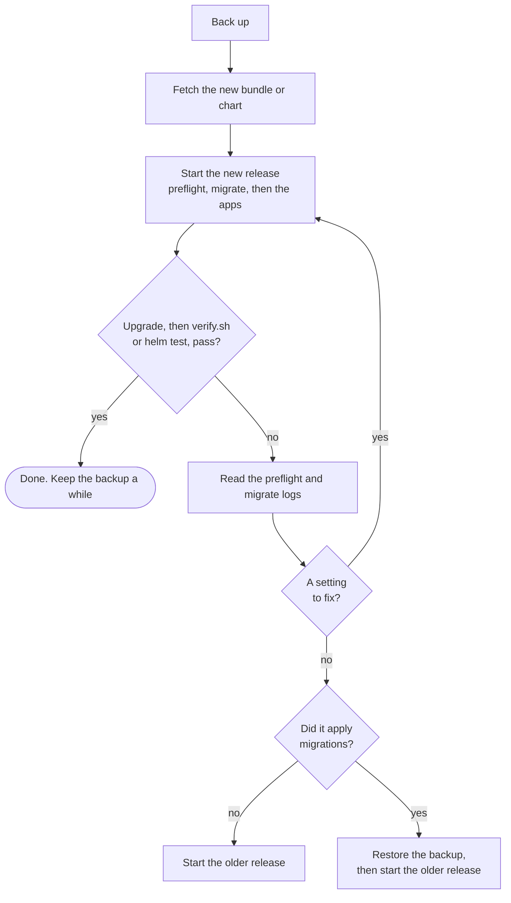

# Operations

[Self-hosting overview](../self-host.md) · Operations

## Versions

- Releases are tagged `vX.Y.Z`, and the bundle and images carry the same tag; the Helm chart is `X.Y.Z`. There is no
  `latest` tag: you always choose a version.
- The six Exagram images and the chart are pinned by digest, signed by the release workflow, and scanned for known
  vulnerabilities before release. Verify them with `cosign verify` (see
  [Install with Docker Compose](install-compose.md#1-download-the-bundle)). The bundled database is the official
  `postgres:18` image, by tag, so a pull can bring a newer Postgres 18 patch release.
- Fixes ship in a new release. Older releases aren't patched, so stay on a recent one.
- Migrations only go forward. Going back to an older release after an upgrade means restoring the backup taken before
  it.

**Which version am I on?** Compose: `cat VERSION` in the `exagram/` folder. Helm: `helm list --namespace exagram` shows
the chart and app version.

## Verify

`./verify.sh`, in the `exagram/` folder, checks a running Compose install: readiness, OAuth metadata, the two origins,
every service against `COMPOSE_FILE`, `preflight` and `migrate` having succeeded, and the migration version. It ends
with `all checks passed`.

With an S3 or GCS store, pass one uploaded object's storage key so it also checks the bucket (anonymous read and listing
refused, CORS allowing the browser upload). Without it those checks print `WARN: skipped` and the script still exits 0:

```sh
VERIFY_OBJECT_KEY=<storage key> ./verify.sh
```

`VERIFY_PUBLIC=1` checks an `--tls external` install through the proxy in front instead of at the plain-HTTP port.
`VERIFY_ENV_FILE`, `VERIFY_PROJECT` and `VERIFY_CURL_OPTS` point it at another env file, compose project or curl
options.

On Helm, `helm test exagram --namespace exagram` checks from inside the cluster that `api` and `usercontent` are ready;
with `tls.mode=acme` it also checks that Caddy redirects `APP_HOST` to HTTPS, and with `tls.mode=ingress` that Caddy
serves the app and routes both names. It doesn't check HTTPS or the worker. After DNS and certificates are in place,
`smoke.sh` from the bundle checks the public origins:

```sh
exagram/smoke.sh https://exagram.example.com https://exagram-files.example.com
```

## Monitor

### Health endpoints

| Endpoint                     | Answers                      | Means                                                                |
| ---------------------------- | ---------------------------- | -------------------------------------------------------------------- |
| `https://APP_HOST/readiness` | `200 OK`, or `503 NOT READY` | The api is up, not shutting down, and listening for database changes |
| `https://UC_HOST/readiness`  | `200 OK`, or `503 NOT READY` | `usercontent` is up and not shutting down                            |

Neither endpoint queries the database or the store on each call, so pair them with an end-to-end check. A good external
monitor: `GET https://APP_HOST/readiness` and `GET https://UC_HOST/readiness`, each expecting `OK`, every minute, plus
an alert on certificate expiry for both host names. The `worker` has no endpoint; watch its log.

Compose runs the api's endpoint as its healthcheck; Helm uses both as readiness probes.

### Logs

Every app logs JSON lines to standard output; Caddy logs JSON too.

```sh
docker compose logs -f api worker usercontent caddy        # Compose
kubectl --namespace exagram logs -f deploy/exagram-worker  # Helm, one app at a time
```

`LOG_LEVEL` (default `info`) sets the detail; a few worker jobs log at `info` regardless. Logs carry request paths and
client addresses. Who read what is not in the logs: it is in the Ledger, which Admins see in **Settings → Audit**.

### What to watch

- `/readiness` failing, or a service restarting.
- Disk space on the machine or volumes: with the bundled store, every upload lands there.
- Certificate renewal (Caddy's own TLS): errors in Caddy's log.
- Backups: that the scheduled job ran and its files aren't empty.

## Upgrade



Before every upgrade:

1. Take a backup (see [Backup](#backup)) and keep it until the new version has run for a while.
2. Pick a quiet time: the apps restart, and the upgrade waits for migrations.

### Upgrade with Compose

From the folder that holds `exagram/`, extract the new bundle over the old one and restart:

```sh
VERSION=vX.Y.Z
docker run --rm ghcr.io/cleverse/exagram-deploy:$VERSION | tar x
cd exagram
docker compose pull
docker compose up -d
./verify.sh
```

Verify the bundle with `cosign verify` first, as at install. Your `.env` is kept: the bundle doesn't contain one.
`preflight` and `migrate` run on every `up`; `migrate` does nothing when no migration is pending. If `preflight` fails
after an upgrade, the new release checks a setting more strictly; its log names it (see
[Troubleshooting](troubleshooting.md)).

### Upgrade with Helm

```sh
helm upgrade exagram oci://ghcr.io/cleverse/charts/exagram --version X.Y.Z --namespace exagram \
  --reset-then-reuse-values --wait --wait-for-jobs --timeout 15m
```

Or pass your values file with `-f values.yaml` instead of `--reset-then-reuse-values`. Don't use `--reuse-values`: it
ignores defaults the new chart adds. Each upgrade runs a new migrate Job, `exagram-migrate-<revision>`. If it fails, the
upgrade fails. When the release changes the schema, `api`, `worker` and `usercontent` keep running the old version
(their new Pods wait for the new schema version); `web` doesn't wait, so the new web app may already be serving. When it
doesn't change the schema, the new Pods start anyway; read the Job's log (see
[Troubleshooting](troubleshooting.md#on-helm)).

### Roll back

- **Compose:** extract the older bundle the same way and run `docker compose up -d`.
- **Helm:** `helm rollback exagram <revision> --namespace exagram`; `helm history exagram --namespace exagram` lists
  revisions.

If the release you're leaving applied migrations, the older one won't start on the newer schema: restore the backup you
took before upgrading (see [Restore](#restore)), then start the older version. Changes made since the backup are lost.

## Backup

Back up three things: the secrets, the database and the files. Losing the database or the files loses data. Losing the
secrets loses the bundled database's password.

People stay signed in and AI tools stay connected, since sessions and AI tools' tokens live in the database; revoke
those in the app.

| What                 | Compose                                 | Helm                                                                                                |
| -------------------- | --------------------------------------- | --------------------------------------------------------------------------------------------------- |
| Secrets              | `.env`                                  | The Secret `exagram` (or yours), any Secret in `envFrom` or for a database CA, and your values file |
| Database, bundled    | `pg_dump` from the `postgres` container | `pg_dump` from `exagram-postgres-0`                                                                 |
| Files, bundled store | The `objects` volume                    | The `exagram-objects` volume                                                                        |
| Brought layers       | Your provider's backups                 | Your provider's backups                                                                             |

Nothing backs up automatically; schedule these yourself (a nightly cron job is enough for most installs) and copy the
results off the machine. The commands below make each file readable by you alone; keep the copies as protected as the
secrets and data they hold.

**Compose**, in the `exagram/` folder:

```sh
(
  umask 077
  cp .env env.backup
  docker compose exec -T postgres pg_dump -Fc -U exagram exagram > backup.dump
  docker run --rm -v exagram-selfhost_objects:/data alpine tar czf - -C /data . > objects.tar.gz
)
```

**Helm:**

```sh
(
  umask 077
  kubectl --namespace exagram get secret exagram -o yaml > exagram-secret.yaml
  # and each Secret you created yourself, e.g. exagram-features:
  kubectl --namespace exagram get secret exagram-features -o yaml > exagram-features.yaml
  kubectl --namespace exagram exec exagram-postgres-0 -- pg_dump -Fc -U exagram exagram > backup.dump
  kubectl --namespace exagram exec deploy/exagram-api -c api -- tar czf - -C /var/lib/exagram/objects . > objects.tar.gz
)
```

**Brought layers:** restore the database and the bucket to the same point in time. The database holds object keys, so a
bucket older or newer than the database leaves missing or orphaned files.

## Restore

Restore into the same release version the backup came from, then upgrade if you need to. Keep the apps stopped until
both the files and the database are back: the worker deletes stored files the database doesn't know about, and a file
restored before its database would look like one.

**Compose**, in the `exagram/` folder:

1. Stop the install, if it runs: `docker compose down`.
2. Put `.env` back.
3. Files: restore the `objects` volume, or your bucket.

   ```sh
   docker run --rm -v exagram-selfhost_objects:/data -v "$PWD":/backup alpine tar xzf /backup/objects.tar.gz -C /data
   ```

4. Database: start only Postgres, wait until `docker compose ps` shows it healthy, then empty the database and restore
   into it. Restoring over existing tables fails on the job queue's partitions, so drop and recreate first:

   ```sh
   docker compose up -d postgres
   docker compose exec -T postgres dropdb -U exagram --force exagram
   docker compose exec -T postgres createdb -U exagram exagram
   docker compose exec -T postgres pg_restore -U exagram -d exagram < backup.dump
   ```

   With your own database, restore through the provider.

5. `docker compose up -d`, then `./verify.sh`.

**Helm**, into a new or emptied namespace:

1. Restore the Secrets before installing, so the chart reuses them: `kubectl create namespace exagram` (skip it if the
   namespace exists), then `kubectl --namespace exagram create -f exagram-secret.yaml`, and the same for each Secret you
   backed up.
2. Install the chart with the same version and values as before.
3. Stop the web proxy and the worker, and wait for their Pods to go: the proxy is the only way in from outside, so no
   request reaches the api during the restore. Then restore the files through the api's Pod (with a bucket, restore the
   bucket instead):

   ```sh
   kubectl --namespace exagram scale deployment exagram-web exagram-worker --replicas=0
   kubectl --namespace exagram wait --for=delete pod -l 'app.kubernetes.io/component in (web,worker)' --timeout=5m
   kubectl --namespace exagram exec -i deploy/exagram-api -c api -- tar xzf - -C /var/lib/exagram/objects < objects.tar.gz
   ```

4. Database: stop the other apps, empty the database, restore, then start all four. With your own database, run the
   first two commands, restore with your provider's tools, then run the last two.

   ```sh
   kubectl --namespace exagram scale deployment exagram-api exagram-usercontent --replicas=0
   kubectl --namespace exagram wait --for=delete pod -l 'app.kubernetes.io/component in (api,usercontent)' --timeout=5m
   kubectl --namespace exagram exec exagram-postgres-0 -- dropdb -U exagram --force exagram
   kubectl --namespace exagram exec exagram-postgres-0 -- createdb -U exagram exagram
   kubectl --namespace exagram exec -i exagram-postgres-0 -- pg_restore -U exagram -d exagram < backup.dump
   kubectl --namespace exagram scale deployment exagram-api exagram-worker exagram-usercontent exagram-web --replicas=1
   kubectl --namespace exagram rollout status deployment exagram-api exagram-worker exagram-usercontent exagram-web --timeout=5m
   ```

5. `helm test exagram --namespace exagram`.

Sessions in the backup that haven't expired keep working, and files open as before. Both procedures are tested end to
end (see [Provider status](configuration.md#provider-status)); test yours once before you need it.

## Move to another database

Stop the apps before you point them at another database. On Helm, an upgrade starts the new api before it stops the old
one, so for a moment both would take writes, each into its own database.

**Compose:** `docker compose down`, copy the database ([Backup](#backup), then step 4 of [Restore](#restore) into the
new one), change the URLs in `.env`, then `docker compose up -d` and `./verify.sh`.

**Helm:**

1. Stop the apps and wait for their Pods to go:

   ```sh
   kubectl --namespace exagram scale deployment exagram-web exagram-worker exagram-api exagram-usercontent --replicas=0
   kubectl --namespace exagram wait --for=delete pod -l 'app.kubernetes.io/component in (web,worker,api,usercontent)' --timeout=5m
   ```

2. Copy the database: `pg_dump -Fc` from the old one, then `pg_restore` into the new, empty one.
3. `helm upgrade` with the new `database.*` values, then start the apps:

   ```sh
   kubectl --namespace exagram scale deployment exagram-api exagram-worker exagram-usercontent exagram-web --replicas=1
   kubectl --namespace exagram rollout status deployment exagram-api exagram-worker exagram-usercontent exagram-web --timeout=5m
   ```

4. `helm test exagram --namespace exagram`.

## Uninstall

**Compose:** `docker compose down` stops the install and keeps the volumes. `docker compose down -v` deletes them, and
every file and the bundled database with them.

**Helm:** `helm uninstall exagram --namespace exagram` removes the release but keeps, on purpose, the Secret `exagram`,
the database volume (`data-exagram-postgres-0`) and the `exagram-objects` and `exagram-caddy-data` volumes; a later
install into the same namespace picks them up again. To delete everything, after a backup:
`kubectl delete namespace exagram`.

## Background work

The `worker` runs on its own; there is nothing to schedule.

- It parses each upload for search. A parse that was never queued (for instance, the database went away mid-upload)
  isn't retried; that file stays out of search until it is uploaded again.
- With the filesystem store, it deletes an upload no Revision references once it is 24 hours old (it looks back seven
  days, so after a longer worker outage older ones stay), and a crashed upload's temporary file after an hour. With a
  bucket, abandoned uploads stay (see [bucket requirements](configuration.md#bucket-requirements)).
